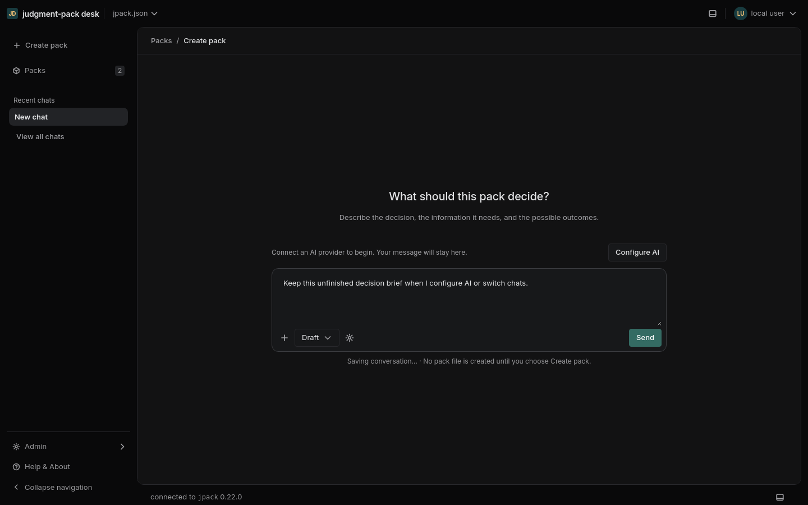
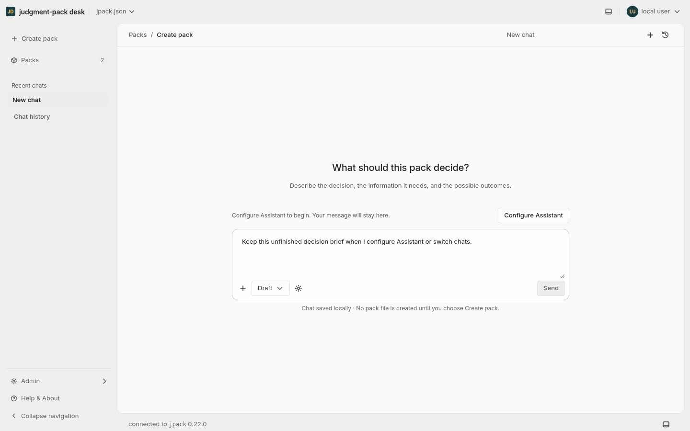
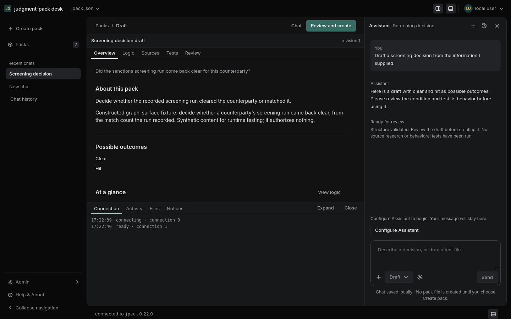
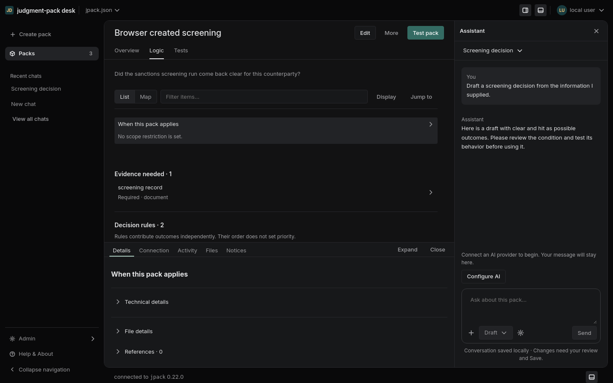
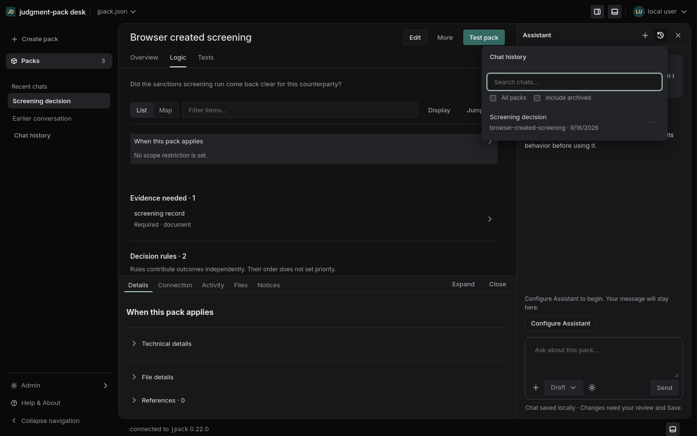
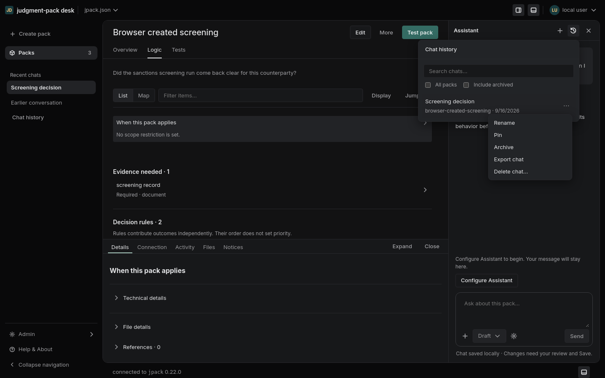
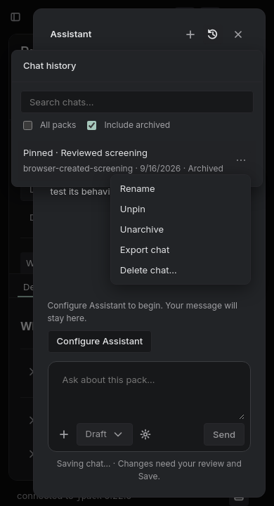
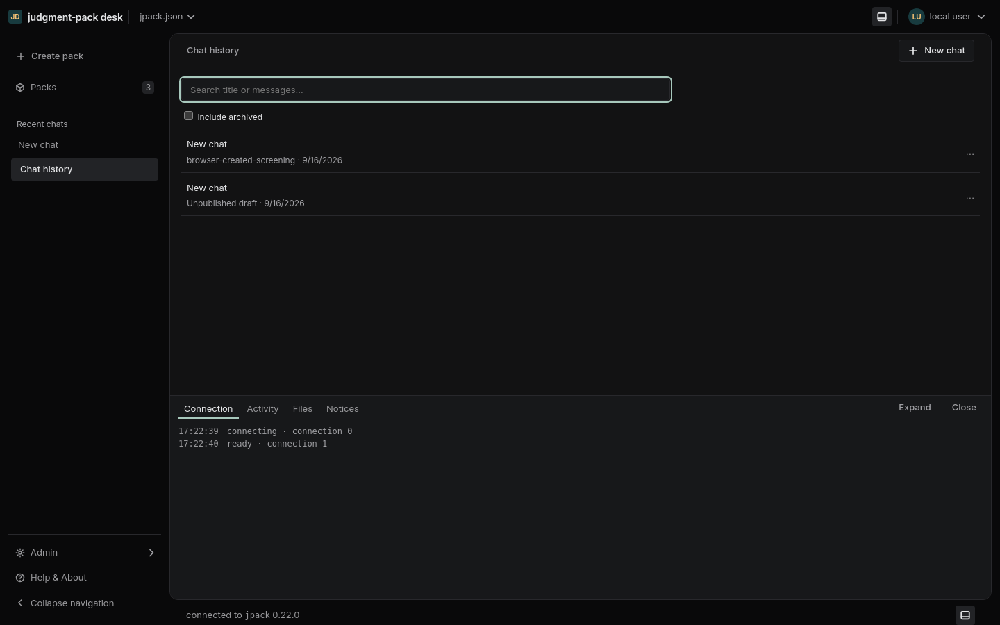
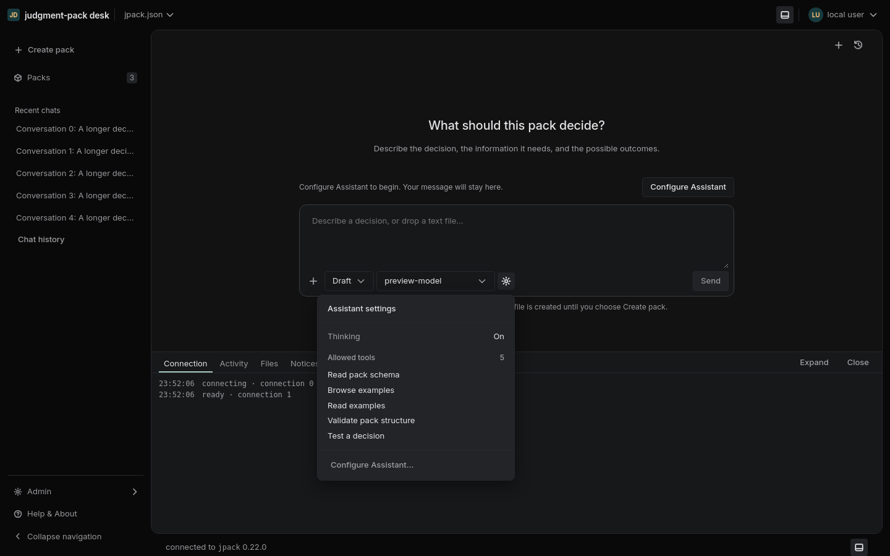
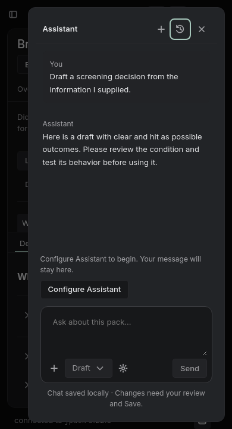

# Chat workspace

Status: chat workspace merged in #91; home and menu refinements follow in #99.
Storage and engine decisions are recorded in [ADR 0002](../adr/0002-project-conversations-and-chat-workspace.md).

The current Create page asks for metadata before the conversation, loses the run
on navigation, and makes the reader choose between details and the assistant.
The replacement starts with a single composer. Opening a draft docks the same
chat beside it; creating a pack links that chat to the saved pack.

## Regions and transitions

- Left: New chat, Packs, then recent chats. Chat history opens the project history page.
  Packs retains its Create pack action, which opens the same chat workspace.
  The navigation does not open a manual creation wizard.
- Main: conversation until the person chooses Open draft; then the draft, its
  sources, tests, and final review. Do not automatically move focus on generation.
- Right: the attached chat on authoring and pack document routes. Its session title labels the pane; Chat history contains New chat.
  History opens in a bounded, nonmodal popover; the conversation stays mounted underneath. One pack may have multiple conversations.
- Bottom: selected details and Activity, underneath main only. The Assistant
  stays full height. Both dividers use the same accessible separator component.
- Narrow screens: explicit Chat/Draft navigation; no forced three-column layout.
- Missing configuration: retain the composer and explicitly open Configure Assistant using
  Admin's existing form. Include a link to the full Admin page.

Home stays at `/` and opens an unsubmitted composer. Merely visiting home,
reloading, typing or choosing New chat creates no saved conversation. The first
accepted Send promotes that draft into history, once. New chat from a pack retains the explicitly
shown pack context. Switching conversations restores the draft, text, model and
view. It never submits, cancels, or changes a running task. One active operation
per project in each window is allowed initially, with an explicit Stop action. The first send
names a chat; rename, pin, archive and delete affect history, never pack files.

## Persistence and trust

Conversation checkpoints live outside the project under the chassis' protected
local configuration directory. The API is authenticated and origin checked,
project scoped, size bounded, versioned and optimistic-concurrency checked.
Files are owner-only, opened without following links, and replaced atomically.
Completed conversation checkpoints never live in browser storage. An unsent home
composer is cached in sessionStorage for this tab and project, so reload does not
discard it. First Send or explicit New chat clears that cache. API keys remain
in the protected key store.

Persisted readiness, receipt verdicts, checks and approval tokens are not
authority. Restoring a checkpoint must make creation unavailable until sources
and expectations have been verified and the exact candidate rechecked. Reload
never starts paid work. Unsaved persistence failures remain visible and prevent
a false "saved" indication. Deleting a chat does not delete a pack or its
research record. Existing explicit expectation-approval and Create gates remain.

## Visual rules

Use existing tokens, Radix primitives and typography. Selection uses neutral
surfaces and unchanged text colors; green and gold are restrained semantic
accents. Keep headers and composers outside their scrolling content. Details
are supplemental, not a second copy of the main document. Controls describe
actions (Open draft, New chat, Create pack), and activity reports actual work.

The attached Assistant is denser than full-page chat: 13px messages and composer
text, 1.5 line height, density-field gaps between messages, and density-block
insets. Markdown headings stay within the 13–14px hierarchy. Metadata remains
12px; buttons retain their shared target sizes. The composer starts at two lines,
expands for multiline drafts, and keeps Enter/Shift+Enter behavior. These shared
pane rules apply to Inputs, saved and draft packs, and graphs without route-local
font or density overrides.

## Message navigation and research choices

Main and attached chat use the same header controls. Jump to message opens an
ordered list of the current session's user messages, with excerpts, timestamps,
and local filtering. Every opening starts at the bottom, including reopening
after a jump. Choosing a message scrolls only the transcript and focuses that
message; Escape closes the list and restores its trigger. Chat history remains
for switching sessions and creating a new chat. The two lists cannot be open
together.

User messages keep Copy message and eligible Retry response actions at the top
right beside their timestamp. Controls remain keyboard and touch accessible.
Retry is available for the latest failed, interrupted, or budget-limited response
when the existing run permits it; it reuses that request without duplicating the
user message or consuming unsent composer text. Reload alone never retries.

Chat can suggest Research for a request that would benefit from broader web
sources. Use Research and Keep Chat are explicit, per-message choices; they do
not change the session's default mode. Before-send suggestions retain the
original composer text and attachments until the user chooses. Direct requests
to research already authorize research; reading a supplied URL still works in
Chat. A host gate also pauses broader search and website exploration when a
model attempts them without a recorded choice, including when the local intent
heuristic does not recognize the language. This appears as Research suggested,
not a failed tool call. Search policy and configuration restrictions still apply.

## References

- Linear, [Behind the latest design refresh](https://linear.app/now/behind-the-latest-design-refresh): quieter navigation and compact consistent controls.
- Linear, [Linear Agent](https://linear.app/docs/linear-agent): persistent conversations, recent history and visible running state.
- WAI-ARIA, [Window Splitter](https://www.w3.org/WAI/ARIA/apg/patterns/windowsplitter/): focusable separators, range values and keyboard resizing.

These inform the design; they are not a claim to reproduce Linear's private
design system. Validation covers restore and session isolation, long text,
small viewports, keyboard resizing, configuration recovery and creation gates.

## Verification

- Web production build and component/engine regression suite.
- Native runtime replay of expectation admission and explicit correction.
- Go custody, authentication, origin, size, unsafe-file and stale-write tests.
- `scripts/chat-workspace-check.mjs`: isolated browser flow through setup,
  session switching/reload, header placement, nonmodal history and focus, fresh validation, draft logic, keyboard/pointer
  resizing, short/narrow windows, creation and retained conversation.
- `scripts/containment-check.sh`: the existing route/width/pane matrix, extended
  to include a real saved conversation. Main-chat routes have no second
  Assistant pane, so their valid configurations exercise the bottom panel only.

Browser checks use a copied runtime project, temporary private configuration,
and an owned server process. They do not call a model or change the running Desk.

The title-bar follow-up passes all 15 isolated browser scenarios, including
nonmodal history, context-preserving New chat and two-stage Escape in a drawer.
The initial workspace layout sweep exercised 508 configurations; 485 passed and 23 hit an
obsolete assertion that the right divider must end above the bottom panel.
The assertion now checks the full-height right pane, its matching divider,
and the bottom panel staying beneath main only. All 124 desktop configurations
were rerun and passed, including all 23 affected cases. The default gate still
runs all breakpoint widths; an optional scoped rerun explicitly labels its
limited coverage. The copied fixture remained unchanged.

## Screenshots

Real browser renders using an isolated fixture, without a model call:

## September 16 follow-up: naming and compact chat controls

The audit found two header rows for one Assistant, a title dropdown hiding New
chat, a modal history browser obscuring the pack, and setup called both AI and
Assistant. Sending without configuration also opened an unexpected setup modal.

| Meaning | UI label | Removed variants |
| --- | --- | --- |
| Feature and pane | Assistant | AI as the feature name |
| Provider setup action | Configure Assistant | Configure AI |
| Settings menu | Assistant settings | AI settings |
| User conversation | Chat / New chat / Chat history | Mixed session/conversation labels in controls |
| Legacy assisted creation choice | Draft with Assistant | Draft with AI |

Provider names, model IDs, engine contracts and runtime research-session terms
retain their technical meanings. No stored data or API was renamed.

New chat and Chat history share the existing title bar with Close. The landing
page has these icon actions without a breadcrumb or redundant New chat title. Both icons reuse the
16px glyph system, neutral button states and Radix tooltip primitive. The
main chat uses the same toolbar in its page header, without another divider.
The history popover is searchable, marks the current chat neutrally and retains
rename/pin/archive/export/delete. Pack history defaults to that pack; project
history has its own page. Returning from history preserves the composer and
conversation DOM. It uses a 24rem width constrained by viewport gutters and a
scrollable list below its search field. Assistant settings uses the same shared
Popover primitive at 20rem, with labeled Thinking and Allowed tools sections.
Escape returns to chat, including inside a narrow-screen
Assistant drawer; a menu retains its own Escape handling.

Setup appears only after an explicit Configure Assistant action. Its label and
form match Admin. Send remains disabled until configuration is available; an
unsent prompt stays editable. Closing setup restores focus to the actual opener.

References reviewed (these inform our adaptation, not an exact replica):

- [Linear's design refresh](https://linear.app/now/behind-the-latest-design-refresh):
  predictable action placement, restrained navigation and fewer separators.
- [Linear Agent](https://linear.app/docs/linear-agent): history is available from
  the agent toolbar, and chats retain context over time.
- [Claude Code in VS Code](https://code.claude.com/docs/en/vs-code): top-of-panel
  history, searchable previous conversations, and session rename/archive.
- [Codex IDE extension](https://learn.chatgpt.com/docs/codex/ide): keep chat and
  review beside the current work. The installed extension also declares a New
  Chat command and an icon-based New Agent action.

## Home lifecycle follow-up

The home route remains `/`; its current conversation is retained in browser
history state. Existing `/chats/:id` links still open saved conversations, and
`/create-pack` resolves to home. Draft promotion keeps the same live worker,
composer and run identity. A blocked Send never creates history. Opening a pack's
Assistant uses the same deferred creation rule. Empty legacy history entries are
hidden, without deleting stored records.

The isolated browser check now covers 20 scenarios, including zero history
writes across home visits, typing, setup, reload and repeated New chat actions.
Store regression tests cover first accepted Send, subsequent sends, restoring an
unsent draft and project isolation. The browser flow also checks popover width,
focus restoration, history actions and Escape inside the narrow Assistant drawer.

## Follow-up: available actions and nested menus

The landing invitation is “What would you like to work on?” with a neutral
question/task composer. Pack creation is one suggested task, while a conversation
inside an open pack retains explicit pack context. This follows the broad entry
point shown in [Linear Agent](https://linear.app/docs/linear-agent), rather than
asking everyone for pack metadata before a conversation.

New chat keeps a stable toolbar position but is disabled when both the composer
and conversation are empty. Whitespace does not enable it; draft text, messages
or a generated candidate do. The history row uses the shared 16px More icon
centered in its 28px control, with equal content and action gutters. Menus use a
shared layer above dialogs and popovers and below tooltips, so an action menu
opened inside history cannot lose its first item behind the parent. Radix still
handles viewport collisions, keyboard opening, focus restoration and Escape.
The actions tooltip is suppressed while its menu is open.

These are Desk adaptations of Linear’s [2026 design refresh](https://linear.app/now/behind-the-latest-design-refresh): predictable action placement, quieter
secondary controls and restrained borders. Linear’s public articles do not
specify a private token scale or require our exact disabled-button behavior.
Browser checks hit-test all nested menu items, verify icon centering, and cover
the same action menu inside the narrow Assistant drawer.

On narrow screens, a popover opened within the modal Assistant drawer joins
that existing modal stack. This is based on the trigger's owning surface, so
route-owned portals cannot cause a click inside history to dismiss the drawer.
Desktop history stays nonmodal. Escape dismisses actions, then history, then
the drawer, restoring focus at each level.

## Conversation and agent feedback sweep

A question is a complete interaction. The assistant answers greetings and ordinary
questions directly. It retrieves the runtime's authoring instructions through a
host tool only when authoring is needed. Ordinary fenced code examples remain
messages; a pack still requires the explicit proposal envelope. Research tools can
be selected later in a conversation. A Chat draft can be upgraded to Research;
once a research candidate exists, switching back cannot bypass its source and
expectation checks.

Message completion and draft readiness are distinct. Completed replies restore
without a stopped banner. An interrupted response never restarts automatically.
Saved candidates always lose check authority and need an explicit recheck before
creation. Questions beside a saved draft do not automatically recheck it or spend
a repair turn. A retry is an explicit action, with the original context and no
second copy of the person's message.

The transcript renders CommonMark/GFM, including source links, lists, tables and
copyable code. Raw HTML is not executed, remote images are not fetched, and links
are restricted to HTTP(S). Streaming prose is ephemeral: proposal fences are held
back and never displayed as a candidate before extraction. Stop discards late
responses. Interrupted prose is marked as interrupted rather than presented as a
completed answer. Screen-reader announcements report completion rather than every
streamed chunk.

There is one transient task status. Tool calls and results are paired by invocation
ID and appear as one step in a collapsed Work summary for the latest request.
Provider schema compatibility notices stay in Activity; significant refusals and
review feedback remain available. Model reasoning effort and optional adversarial
review are separate settings. Available tools are read from the connected runtime
and the current research configuration; configured tool names alone do not imply
availability. Runtime structure checks always remain mandatory for candidates.

Draft review has one entry action. Chat remains usable while the final review is
open; a different candidate digest closes that review and requires another review.
A proposal requested in View can be reviewed in Edit without regeneration, only if
the exact path and bytes are unchanged. After the transition, the editor's normal
generation/revision guards still reject stale applications. Applying remains an
undoable buffer change, followed by explicit Save.

Attachments are removable preview chips, kept separately from composer text and
included as reference material on Send. Context identifies the current pack and
lets the person inspect the bytes being supplied. Requests exceeding the local
200,000-character context ceiling stop before a model call, with guidance to start
a focused chat; nothing is silently truncated. This is a character budget, not an
estimate of a provider's token capacity. Opening a chat, typing, pinning and changing
models do not alter conversation recency. History groups pinned and recent chats,
and identifies working or interrupted tasks. Scrolled-up readers can use Jump to
latest. Headers and the bounded, growing composer remain outside the transcript.

These choices apply Linear's public guidance on
[agent interaction and ephemeral activity](https://linear.app/developers/agent-interaction)
and [agent interface feedback](https://linear.app/developers/aig), alongside
[Claude Code's focused conversation interface](https://code.claude.com/docs/en/vs-code#use-the-prompt-box).
They are Desk's implementation decisions, not Linear pixel specifications.

Additional verification: `scripts/chat-response-check.mjs` uses real Desk/runtime
connections with deterministic model replies intercepted in the browser. It checks
quiet greetings, Markdown, attachments, review continuity, Stop/retry, scrolling,
endpoint refusal/recovery and narrow layouts without saving an API key or calling
an external model. The unused SDK telemetry path is explicitly disabled in both
model loops: SDK 7.0.93 leaves its tracing completion promise unclaimed in a
browser on cancellation or refusal. No global rejection filter hides errors.

Runs remain local to this browser window. Durable background scheduling, automatic
history summarization, PDF/image attachments and multi-window write-conflict merging
are separate work; the interface does not claim those capabilities.

Attachment ingestion and attachment presentation are separate shared components.
Local UTF-8 text files retain the four-file/200 KB-per-file limits and can be
previewed or removed without editing the prompt. Reading a batch blocks Send
(including Enter), offers Cancel, and discards late results after leaving the
chat. A rejected batch adds no partial context. Pending local reads are not saved
as completed attachments. Gateway-backed PDF and connected-source choices will
use the adapter contract when available; unsupported choices are not advertised
in the composer.

### Pack and graph conversation context

The Assistant belongs to the pack or graph, including an independent draft. It
keeps the selected conversation and unsent composer across Overview, Logic,
Sources, Tests and Review. History defaults to that exact owner; All chats is an
explicit broader search. Pack and graph ids are different scopes. Switching a
conversation preserves the current workspace view, and selecting a graph draft
conversation preserves the chat that holds the graph artifact.

A compact context row above the composer names the current pack or graph and
opens the exact document context. Saved test inputs and observations accompany
messages as reference material, separate from user-authored requirements. Pack
observations identify whether their pack and case snapshots still match; graph
observations retain their runtime digests. Reading a tab or restoring a chat
never runs tests automatically.

The Tests view uses the same attached conversation. Design with AI explicitly
opens the reviewed test-design task in the main workspace; its existing
per-pack proposal records and source controls remain available there. It cannot
compete with an active attached conversation, and generation reserves the chat
composer until it finishes or is stopped.

New chat and History remain visible in the shared header. Sources and draft
shortcuts share the secondary options menu. Expanded narrow layouts use a back
icon and keep the chat controls visible. Pack and graph editors use the same
saved pane width, typography, spacing and composer context component.

## October 10: readable output and shared chat controls

Main and docked chat use the same bounded message measure. Tables and code no
longer widen the message independently. Each has a labeled toolbar and expand
icon, a focusable scroll area capped at 24rem, and horizontal overflow for
long fields or unwrapped code. Code starts unwrapped in chat; Wrap remains a
local reading preference, and Copy always copies the full source.

The expand icon opens a wide shared dialog (up to 80rem within viewport gutters), with a
65dvh scroll area and a fixed Close action. Tables keep column headers visible
while scrolling. Escape and Close return focus to the triggering expand button.
Markdown remains sanitized; the larger view does not load remote images or
execute model-authored HTML. Streaming updates retain the open viewer.

The pane heading is the active session title and remains attached across pack
and graph tabs. Its full title is available on overflow. The redundant context
row above the pane composer is omitted; message-owned artifact cards remain.
The standalone chat and explicit test-design task retain their context views.
Chat history contains New chat, preserving pack/graph ownership and the current
tab. Expanded panes expose Narrower, Wider and Reset width directly, with the
same clamped bounds as the divider. Other workspace tools retain their titles.

## October 11: graph chat parity

Graph and pack conversations share the same artifact reference, reading panel,
header actions, and composer. The graph already open in the workspace has no
duplicate Review graph card in the transcript. A distinct pending proposal stays
visible after the conversation; the Graph drafts reader retains all artifacts and
marks the current draft as Open without a redundant navigation link.

Chat options exposes Graph context or Pack context in docked views, including the
current graph selection and saved test observations. The composer does not repeat
the document title or its review/save commands. Context reading is explicit and
does not execute a test, send a message, or save the document. The same reader
focus and dismissal behavior applies to graph artifacts and pack details.

These choices apply [Linear's action hierarchy and restrained structure](https://linear.app/now/behind-the-latest-design-refresh)
and [contextual proposals reviewed beside the editor](https://www.databricks.com/blog/databricks-assistant-edit-mode-fastest-way-transform-your-notebooks)
to Desk's existing shared components.

## Dialect recipe proposals (local v0.13)

Main chat and the pack/graph right pane share `InputRecipeNotice` and the recipe
review dialog. Chat can inspect saved recipe metadata and retain a proposed
recipe; proposal tools cannot save an input, choose a credential, start research,
or change qualification rules. A separate research request tool uses the explicit
composer allowance described in input-preparations.md. The latest proposal appears as a compact title/metadata row with its review
action. Field lists stay in the review. A saved recipe already open in the Inputs
pane is omitted because its context header identifies it. Saved work and older proposals are grouped by Input in **Related work**. Main chat and other panes use the shared labeled toolbar button; the existing Inputs context header opens the same reader.

**Review recipe** reuses Inputs' fields, target, connection, model and limit
controls. Qualification stays optional under a disclosure. Company and person
research can precede a pack; people-at-company research requires a reviewed
company selection. The dialog has a bounded, scrolling body and fixed,
right-aligned Cancel / Save to Inputs actions. Cancel restores focus, and the
shared unsaved-changes guard protects edited review values.

**Save to Inputs** creates an empty, project-local input and changes the card to
**Open input**. It retains the chat/draft origin and uses that pair for idempotent
creation. Saving never confirms a research run. Research is reviewed and started
separately through the shared manual review or a previously reviewed one-run
composer allowance. No Runtime ownership or spec change is needed for this
Desk authoring interaction.

Record counts, source/model request budgets and automatic retry settings belong
in Recipe → Research → Limits and retries. Free-text intent describes who to find
and what to research, including criteria such as employee thresholds. New chat
proposals keep totals in structured limits. At execution, saved limits and the
host's remaining record/request counts override conflicting totals in old prose;
the original prose and historical recipes stay intact. A record maximum is not a
guarantee or permission to fabricate missing evidence.

Research retries explicit temporary search server failures (500/502/503) and
rate limits under its saved policy, with bounded exponential backoff and jitter.
Timeouts, including provider 408/504, require timeout-retry opt-in. Exhausted
temporary searches are retained as source gaps so other permitted sources and
existing evidence can still be processed. Repeating the failed query does not
bypass its retry limit. Invalid requests/responses, unknown errors, authentication,
policy, and post-acquisition failures remain terminal. Provider text never enters
user-visible diagnostics.

Inputs history includes conversations linked by saved recipe proposals, the recipe's
retained chat origin, and reviewed-action proposals. Opening a saved recipe keeps
its originating conversation in the right pane; an empty automatically created
pane draft does not take precedence over a retained conversation. Explicit New
chat and history selections still take precedence. The Inputs collection shows
Inputs-related chats; a recipe filters to its own related chats. A conversation
can belong to several Inputs without being copied or losing its original main,
pack, or graph location. Navigation, New chat, and research progress use the open
Inputs pane's scope. Existing saved links work without rewriting chat history.

## Compact interview questions

The shared main and Inputs/Library pane chat can request one structured question
through Desk's `ask_user` host tool. It supports two to four options, single or
multiple selection, and an optional recommendation with a short reason. No
answer is preselected. Optional text can supplement a choice or replace it;
open questions can omit choices entirely. Help me decide asks for an explanation
without accepting the recommendation. After a brief explanation, the assistant
can supply a refined question. If it replies with prose alone, Desk re-shows the
retained choices with no selection, without making another model request.

The card uses standard body text, 32px option rows, a one-line expanding text
field and compact actions. Selecting a choice never submits it. Submit answer
retains a user message and collapses the card; its details remain available.
The normal composer can change direction and supersedes the pending question.

At the model boundary, absent option descriptions become empty text and absent
recommendation fields become null. Saved questions remain strictly validated;
choices, labels, recommendations and answers are never invented or silently
rewritten. Invalid questions return a specific, closed validation reason to the
model with instructions to correct `ask_user` in the current turn. Both engines
retain that reason in Work without copying raw provider errors or arguments.
If a corrected question opens in that response, its earlier failed attempts show
Corrected and no longer count as failures. This shared flow applies to main chat
and workspace panes. Historical failures without a recorded reason remain
historical; they do not restart a question or a model request.

Both Vercel and Codex adapters end the model operation at the question. The
checkpoint retains the question, selected options and text. Submission saves the
answer before explicitly starting a fresh turn with the original conversation
and constraints. A failed save keeps an explicit Continue action that retries the checkpoint
with its original revision guard before starting the model; a persistent save
error or revision conflict still blocks continuation. Reload never starts a model call. Completed operations are not replayed. Interview answers
are preferences, not authority to save a recipe, start research or evaluate;
the existing review controls still govern those actions.

Validation: `npm test -- src/chat src/assistant/engines/vercel/engine.test.ts
src/assistant/engines/codex/codex.test.ts src/research/run.test.ts` from `web`.
After `npm run build`, run the disposable full browser fixture from the repo:
`JPS_QUESTION_BROWSER="$PWD/web/scripts/chat-question-browser.mjs" go test
-buildvcs=false ./internal/desk -run '^TestChatQuestionBrowser$' -count=1 -v`.
It uses a local scripted provider, real persistence and a failed-save case,
without accessing the user's conversations or provider accounts.

Chat and interview fields use **Enter to send/submit** and **Shift+Enter for a
new line**, with a quiet, screen-reader-associated hint. Enter on a focused
question choice submits the current answer; choosing it alone does not. The
shortcut uses the same readiness and save checks as the button. Modified Enter,
IME composition (including the key-code 229 boundary), and held Enter never
submit accidentally. Help, clear, and other focused controls keep their native
keyboard behavior. This matches the documented [Slack Enter-key convention](https://slack.com/help/articles/115005523006-Set-your-Enter-key-preference).

Inputs research supplies short, run-local `availableURLs` references to its model.
A read resolves `urlRef` from the retained host journal; the model need not copy
opaque Google redirect tokens. Legacy exact URLs remain accepted. Unknown or
mismatched references are never fetched or repaired by fuzzy matching. The host
retains the declined action and supplies feedback to the next model step within
the saved model limit, allowing two corrections before stopping repeated invalid
proposals. This is a local validation correction, not a source/network retry.
Activity distinguishes the declined action from a completed read. Gateway access
policy, evidence verification and record validation remain unchanged. The model
is directed to save useful candidates after reading supporting evidence and to
leave unsupported fields missing instead of delaying all records for enrichment.

## Composer workflow approvals

Keep work type (**Chat / Research**) separate from **Ask me / Auto within limits**.
Ask me is the default. Auto requires a saved input, exact recipe/connection/limit
review and an explicit **Allow one run** action. It grants this chat one research
start within 15 minutes or one hour in the current signed-in window. The server
owns this permission; restoring a chat preference cannot create it. Expiry,
consumption and revocation return the composer to Ask me. Recipe changes and
additional usage retain their existing reviews.

Main chat can choose a saved input; an input pane defaults to its current input.
The shared control uses existing menu, dialog, fields and actions. The older
research preference is called **Search when needed**, so “Auto” has one meaning
in the composer. Button-triggered Start research still confirms exactly that run
in either mode. See input-preparations.md for admission and audit contracts.

## Inputs research visibility

The Inputs page status row owns compact background research progress, recovery
and budget approvals. View steps owns source counts and detailed explanations. Its docked chat omits the duplicate block and
already-applied references. Main chat and other panes also omit saved recipe and applied-action cards. Pending reviews remain compact and actionable; Related work retains grouped history.

Expanded and narrow-screen chat use the existing `mainCovered` shell contract.
When the page is covered, or an input chat opens on its own, show only a short
research status and Stop while active. Related work owns navigation; opening an Input there reveals the main workspace and keeps the same chat. Keep polling the shared query when
the progress block is hidden so research never causes an empty welcome to reappear.
Conversation-owned Work steps remain in the transcript.

## Related work

One shared reader groups associated work by saved identity. The labeled Related
work toolbar action serves main chat and Library panes. Inputs reuses its context
header with that same visible action label, without another toolbar row. Input
context, Input recipes, Input actions and Graph drafts are no longer separate
ellipsis-menu entries. Context and history are disclosures within each item.
Pending reviews keep the existing guarded review forms.

The shared entry accepts a title, type/status description, icon, destination and
feature-owned actions. Inputs, packs and graphs supply adapters. Jobs can reuse
this presentation without a recipe-specific contract; Jobs does not yet host chat.
Inspecting related work never changes chat context or starts an operation.
Opening covered work reveals the main workspace and preserves the conversation.

### Related work rendering audit

Main chat, the Inputs list/detail pane, saved pack and pack draft panes, and
saved graph and graph draft panes use the same flat Related work reader. Each
entity has one title, secondary type/version text, and an aligned navigation or
review control. Review controls reuse their feature's dialogs and stale/unsaved
edit checks, without wrapping a second artifact card inside the entity row.
At narrow pane widths, actions move below the identity. Context and history stay
collapsed. Current visible work is labelled Open in workspace; when the pane
covers it, its navigation link reveals the main workspace again.

Earlier unsaved input creation proposals live under Earlier proposals, labelled
Not saved. Only the latest creation proposal is presented as a current proposal.
Saved inputs are grouped by persisted ID; equal names do not prove identity and
are never silently merged. Old review controls remain available in history.
Graphs group their revisions by path and ID. An unsaved graph workspace links to
its draft, not a nonexistent saved graph; a saved graph's latest pending update
appears beneath its single entity heading. The context title applies only when
its identity matches that entity.

The generic row is also tested with a Job destination. Jobs has no chat pane;
this does not add one. Navigation/review inspection never starts research or
changes input review decisions.

## Delegated work

Delegated tasks share the existing Work disclosure in main chat and attached
Inputs, pack and graph chat. Each child occupies one row, named for its task,
with the running spinner replacing the chevron. Selecting the row opens the
shared reader with its objective, actual tool steps, findings and any failure.
The main conversation shows the parent's synthesis. Completed child text is not
injected as a separate assistant answer or pinned above the composer.

There is no Agent composer mode: Chat/Research governs source access and Ask
me/Auto retains its workflow approval meaning. Children have bounded read-only
capabilities and share the parent budget. Stop cancels the whole response;
reload retains findings and marks unfinished children interrupted. See
[shared delegated tasks](../adr/0012-shared-delegated-tasks.md) for the execution,
capability and persistence contracts.
